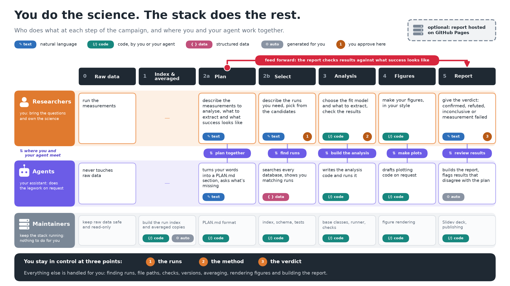
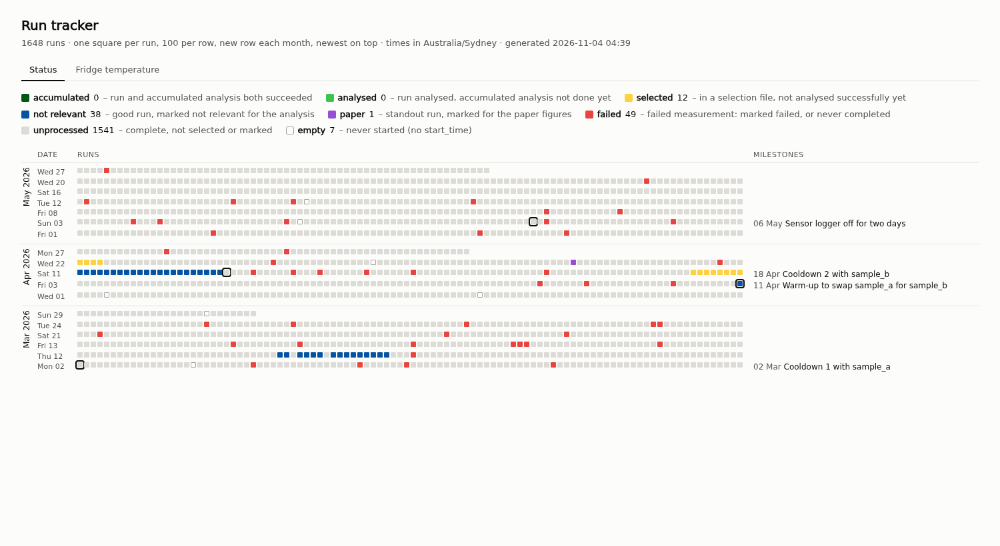
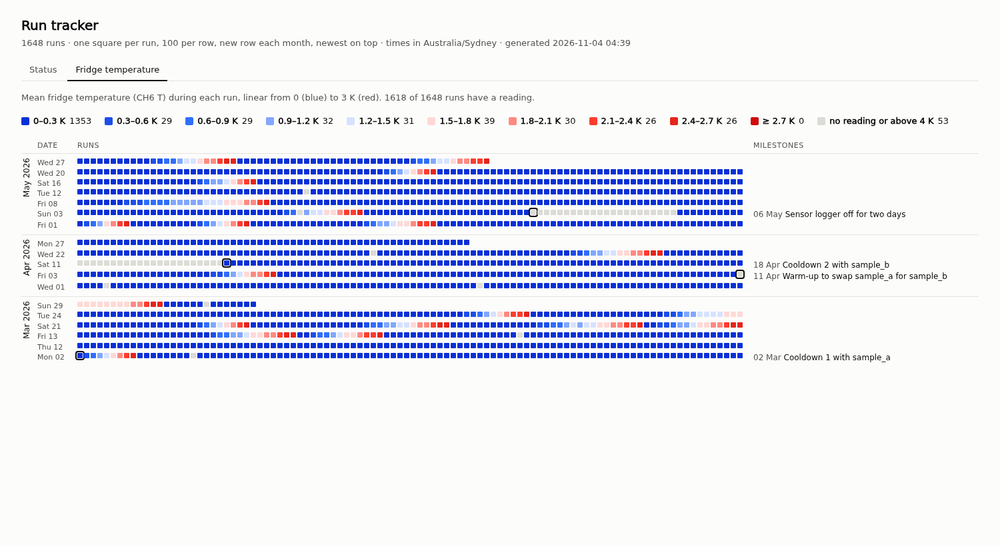
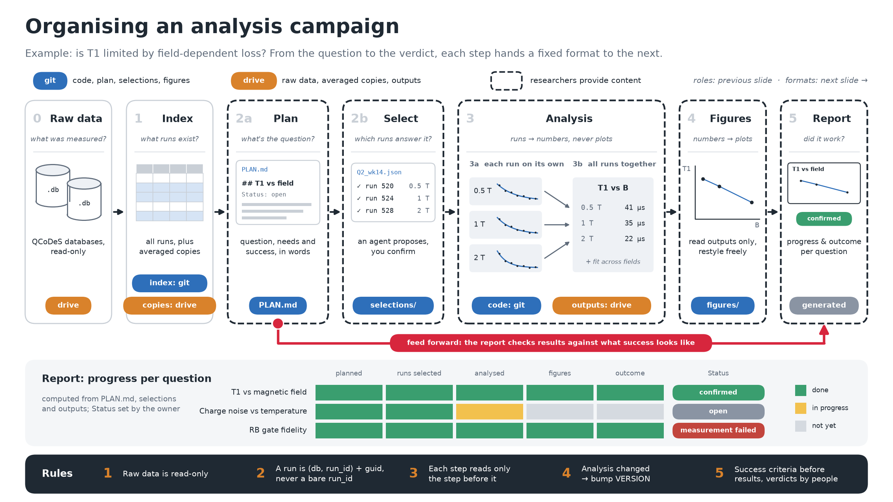
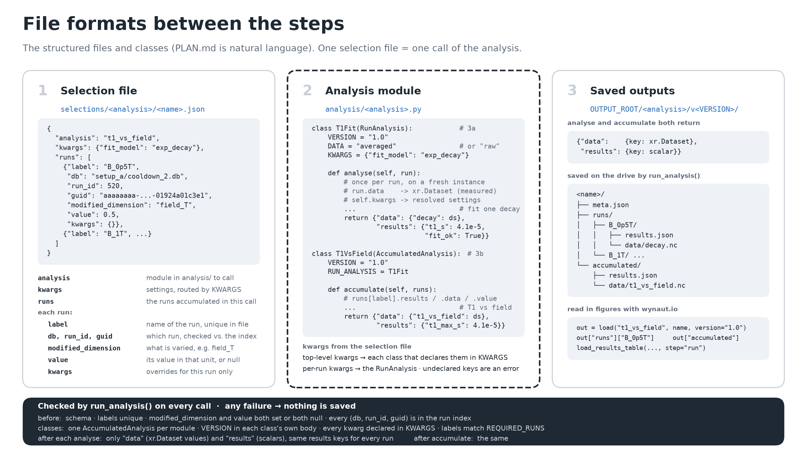

# wynaut

**An agentic approach to collaborative analysis of scattered measurement data.**

A lab collects data for months: thousands of runs spread over many databases,
taken by several people, with the conditions of each run (a temperature, a
pressure, a field) in separate log files. Then several people, and their LLM
assistants, analyse it together. Without structure this goes wrong in familiar
ways: nobody knows which runs were already analysed, results live in personal
notebooks, a fit is quietly changed after the plot looked wrong, and the
assistant confidently loads run 42 from the wrong database.

wynaut is a small framework, and above all a set of **contracts**, that keeps
such a campaign honest while letting agents do most of the mechanical work:

- **Every step has a fixed input and output format.** Questions are plain text
  in `PLAN.md`, run selections are validated JSON, analyses are two small Python
  classes with checked outputs, figures read only saved results. An agent can't
  silently skip a step, because the next step only accepts the previous one's
  format.
- **People approve at three points**: which runs are used, how they are
  analysed, and whether the question was answered. Everything else an agent can
  draft, run and check.
- **The goal is written before the result.** Each question states what success
  looks like before any data is analysed, so git history shows the goal wasn't
  moved afterwards.
- **One contract for people and agents.** [AGENTS.md](AGENTS.md) is a strict
  specification that coding assistants read automatically; humans read this
  README.



> The name is a Pokémon (Wynaut), and the question behind the project: why not
> let agents do the legwork of a data analysis, if the contracts keep them honest?

## See it in two minutes

```bash
git clone https://github.com/andncl/wynaut && cd wynaut
python -m venv .venv && source .venv/bin/activate
pip install -e ".[dev]"

python -m tools.make_demo                 # a fictional campaign in demo/ (gitignored)
export WYNAUT_CONFIG=demo/config.yaml
python -m tools.timeline                  # open build/tracker/runs.html
pytest                                    # the checks every commit runs
```

The demo is a made-up low-temperature lab: two cooldowns of a cryostat with a
warm-up in between, about 1600 runs of five kinds of measurement, and a
thermometer logged once a minute. The committed run index, the example question
in [PLAN.md](PLAN.md), the selection file and the example analysis all belong to it.

### The run tracker

One square per run, in start order, newest month on top. The status tab shows
how far each run has come; it is computed from the selection files, the saved
outputs and runs marked by hand, never stored. Milestones sit beside the timeline.



The sensor tab colours every run by a logged quantity during the run, here the
cryostat temperature, so you can see at a glance which runs were taken at base
temperature, which during a temperature sweep, and which have no log at all.



## How a campaign works

The campaign is a chain of steps. Each step reads **only** the output of the
step before it. The plan feeds forward to the report, so every question shows
how far it has got and whether it succeeded.

| Step | What it answers | Who provides it | Output |
|---|---|---|---|
| **0 Raw data** | What was measured? | the measurements | databases on a shared drive, read-only |
| **1 Index** | What runs exist, and under which conditions? | maintainer, automated | `index/runs.jsonl`: every run, committed |
| **2a Plan** | What do we want to find out? | **text** in `PLAN.md` | the question, what we need, what success looks like |
| **2b Select** | Which runs answer it? | **words** to an agent, then your confirmation | selection files in `selections/` |
| **3 Analysis** | Runs → numbers | **code**, yours or an agent's, approved by you | datasets and results, per run and accumulated |
| **4 Figures** | Numbers → plots | **code** in `figures/<you>/` | figure images |
| **5 Report** | Did it work? | **text**: `Status` and `Outcome` in `PLAN.md` | the run tracker and a report deck |



### The formats between the steps



**A question** is a section of [PLAN.md](PLAN.md): four fixed lines that link it
to analyses and figures, then free text.

```markdown
## Decay time vs magnetic field
Owner: alice
Status: open                 ← open, confirmed, refuted, inconclusive or measurement failed
Analyses: decay_vs_field v1.0
Figures: none yet

### Question
### What we need
### Success looks like       ← written before the results exist
### Outcome                  ← written after, together with Status, by a person
```

**A selection file** is one call of an analysis: the runs it needs, each
identified by its database, run id *and* guid, so a renamed or replaced
database is caught instead of silently loading a different run.

```json
{
  "analysis": "decay_vs_field",
  "kwargs": {},
  "runs": [
    {"label": "B_0p29T", "db": "setup_a/cooldown_2.db", "run_id": 40,
     "guid": "3d8d780f-42d5-b04d-233f-91d562f4de5e",
     "modified_dimension": "field_T", "value": 0.2857, "kwargs": {}}
  ]
}
```

**An analysis** is two classes: one sees a single run, the other relates all
runs of the selection. Both return `{"data": {key: xr.Dataset}, "results":
{key: scalar}}`, and the base classes check every return value, every setting
and every version. Neither class plots, reads or writes files. See
[analysis/decay_vs_field.py](analysis/decay_vs_field.py):

```python
class DecayFit(RunAnalysis):            # 3a: once per run, sees only that run
    VERSION = "1.0"
    DATA = "averaged"                   # or "raw" for shot-by-shot data
    KWARGS = {"t_max_s": None}          # every accepted setting, with its default
    def analyse(self, run): ...         # fit one decay → tau_s, tau_s_err, fit_ok

class DecayVsField(AccumulatedAnalysis):  # 3b: once, on the outputs of all runs
    VERSION = "1.0"
    RUN_ANALYSIS = DecayFit
    def accumulate(self, runs): ...       # tau vs field; never sees raw data
```

The full specification, with every rule and its reason, is in [AGENTS.md](AGENTS.md).

## Everyday use

Most work starts as a request to your agent, in plain words:

- *"I want to know whether the decay depends on the field."* The agent asks
  what you need and what would count as success, and drafts a `PLAN.md` section.
- *"Find the field sweeps of cooldown 2."* The agent searches the run index and
  shows you candidates; you pick, it writes the selection file and runs `pytest`.
- *"Fit an exponential decay to each run, then tau vs field."* The agent drafts
  the analysis; you approve the model and check the results.
- *"Mark runs 266 to 268 of cooldown 1 as failed: wrong attenuation."* The agent
  adds the mark to `report/run_marks.yaml`; the tracker shows it in red.
- *"How far are we?"* The agent rebuilds the tracker and summarises it.

You stay in control of three things: **the runs**, **the method**, and **the
verdict**, which only a person writes.

## Use it for your own campaign

1. **Fork or copy this repo**, one repo per campaign. Delete the demo content:
   the question in `PLAN.md`, `selections/decay_vs_field/`,
   `analysis/decay_vs_field.py`, and the entries in `report/*.yaml`.
2. **Set the shared paths**: copy `config.example.yaml` to `config.yaml`
   (gitignored) and point `data_root` at your databases.
3. **Set the project** in [project.yaml](project.yaml): your timezone, which
   databases to leave out of the index, and optionally the sensor log to attach
   to every run (channel, unit, file layout, and what stands in when the sensor
   is below its range) and the tracker's colour scale.
4. **Build the index**: `python -m tools.build_index`, then
   `python -m tools.index_sensor --batch-days 7 --tracker` (newest week first,
   with progress, updating the tracker as it goes). Commit `index/runs.jsonl`.
5. **Point your assistant at [AGENTS.md](AGENTS.md)** (Claude Code reads it
   through [CLAUDE.md](CLAUDE.md); most other assistants read `AGENTS.md`
   directly) and start with a question.

**Data sources.** The index reads QCoDeS-style SQLite databases (the `runs` and
`experiments` tables) directly; `qcodes` itself isn't needed. For another
source, write a reader that returns the same columns as `wynaut.index.read_runs`.
The sensor reader takes one CSV line per reading (`date,time,value`) from files
laid out by a pattern; set `file_pattern` and `datetime_format` for your logger.

## Repository layout

```
wynaut/
├── AGENTS.md         the contract, for coding assistants (CLAUDE.md includes it)
├── PLAN.md           the questions of the campaign, natural language
├── project.yaml      project settings: timezone, index exclusions, sensor logs, tracker scale
├── index/            the run index, runs.jsonl (generated, committed)
├── wynaut/           the framework: paths, settings, index, sensor logs, plan parser,
│                     base classes, runner, loading outputs
├── selections/       run selection files, one folder per analysis
├── analysis/         one module per analysis, plus _template.py and _common/
├── figures/          one folder per person; figures/paper/ for the agreed final figures
├── report/           milestones and run marks for the tracker; Slidev setup for the report
├── tools/            build_index, index_sensor, timeline (run tracker), make_demo,
│                     merge_wal, export_averaged, build_report
├── tests/            the checks: selection files, PLAN.md, base classes, index, sensors, tracker
├── docs/             slides and screenshots; regenerate with python docs/slides/make_slides.py
└── build/            generated: figure images, run tracker, report (gitignored)
```

## Status

This is an early release, extracted from a real multi-month campaign.

**Working:** the run index from QCoDeS-style databases (including databases with
an unmerged WAL, and `tools/merge_wal.py` to merge one safely); sensor values
per run from log files, with nearest-reading and below-range rules; the
`PLAN.md` parser; validation of selection files against the committed index;
the analysis base classes and all their output checks; the run tracker; the demo
generator; `save_figure`; and the tests behind all of it, run by GitHub Actions.

**Specified in [AGENTS.md](AGENTS.md) but not implemented yet:** loading runs
and saving outputs (`run_selection`), averaged copies (`export_averaged`,
`load_averaged`), reading outputs back (`load`, `load_results_table`),
`describe_run`, and the report generator (`tools/build_report.py`). Their
signatures and docstrings are in place.

## License

[MIT](LICENSE)
